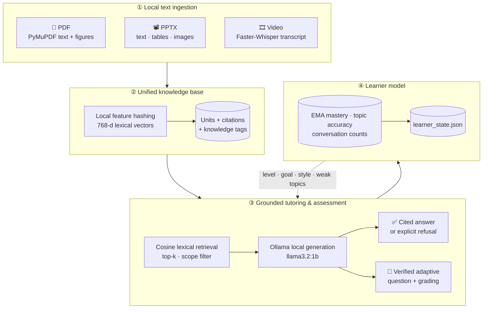

<p align="center">
  
</p>

<p align="center">
  <b>A local-first, source-grounded AI tutor for PDF and slide text that adapts practice and refuses unsupported answers.</b>
</p>

<p align="center">
  <br>
  <i>Track D: Personalized Tutoring &amp; Adaptive Learning</i>
</p>

<p align="center">
  
  
  
  
  
</p>

<p align="center">
  <a href="https://youtu.be/5sruuk1WHsA">
    
  </a><br>
  <b>▶ <a href="https://youtu.be/5sruuk1WHsA">Watch the 3-minute demo</a></b>
</p>

<p align="center">
  <a href="https://youtu.be/5sruuk1WHsA">Demo video</a> ·
  <a href="#screenshots">Screenshots</a> ·
  <a href="#track-d-alignment">Track D alignment</a> ·
  <a href="#architecture">Architecture</a> ·
  <a href="#sample-run-quick-benchmark-10-oct-2026">Results</a> ·
  <a href="#installation">Installation</a> ·
  <a href="#demo-flow">Demo flow</a> ·
  <a href="TRACK_D_STATUS.md">Track D status</a> ·
  <a href="SUBMISSION.md">Submission summary</a>
</p>

---

> **Local-only implementation status:** tutoring, text extraction, lexical
> retrieval, video transcription and optional image understanding run locally
> through Ollama and Faster-Whisper. See [Known limitations](#known-limitations)
> for model requirements.

## Problem

Students study from a mix of lecture slides, PDF notes and recorded lectures.
General-purpose chatbots answer from the open internet rather than from *this*
course, they hallucinate confidently, they do not cite where an answer came from,
and they do not know what a particular student already understands. Practice
questions are generic, repeat themselves, and do not get harder or easier as the
student improves.

## Solution

The local-only LearnLens build currently indexes PDF and PowerPoint text and
builds a tutor around that material:

- **Grounded answers** with page and slide citations — `[file.pdf, Page 3]`,
  `[deck.pptx, Slide 7]`.
- **Honest refusal** when the material does not contain the answer:
  *"Bu bilgi yüklenen ders materyallerinde bulunamadı."*
- **Adaptive, verified assessments** (MCQ, short answer, numerical) whose
  difficulty follows the student's performance.
- **A learner model** that tracks mastery per topic from quizzes, the diagnostic
  and tutoring conversations, and uses it to personalize explanations.
- **Built-in evaluation**: a local-model RAGAS judge, a team-built benchmark,
  refusal accuracy, citation matching and question repetition rate.

## Why LearnLens AI is different

- **Hybrid local knowledge base.** PDF page text, PowerPoint text/tables and
  timestamped video transcripts are indexed locally. Embedded figures and
  uploaded images are not interpreted in this build.
- **Hybrid retrieval.** BM25-style lexical matching is combined with the
  deterministic local vector score so exact course terms remain discoverable
  even without downloading a semantic embedding model.
- **Grounding is enforced and measured.** Strict prompts, citation preservation,
  a fixed refusal sentence, and a benchmark that checks refusals and expected
  sources.
- **Offline tutor workflow.** A planner normalizes the learner question and a
  verifier rejects insufficient retrieval evidence before the local model is
  called.
- **Optional local image Q&A.** If an Ollama vision model is installed, image
  questions run locally through it; text-only installations receive an
  actionable setup message.
- **Honest experiment gating.** Sequence-model experiments are reported as
  not ready until enough labeled learner history exists; local PyTorch DNN and
  LSTM results are never shown without sufficient data.
- **Optional TensorFlow/Keras experiments.** Isolated DNN and LSTM baselines are
  available only when TensorFlow is explicitly installed. TensorFlow is never
  imported during ordinary app startup, so existing PyTorch experiments and the
  rest of LearnLens continue to work without it.
- **Questions are checked twice.** A second local-model pass verifies every generated
  question against the source and rejects anything ambiguous, unsupported or not
  self-contained (including questions that would need a figure the student
  cannot see).
- **Transparent learner model.** A simple exponential moving average per topic,
  documented constants, no black box.
- **Resource-aware.** Retrieval vectors and knowledge tags are cached, tagging
  is batched and need-based, and the benchmark reports local model errors.

## Guided learning flow

The app uses one four-step workflow:

1. **Upload** — add PDF, PPTX, image or video material.
2. **Review Extraction** — inspect page, slide, image or timestamp details and
   the knowledge structure.
3. **Learn** — ask the grounded tutor or generate inline Visual Studio diagrams.
4. **Practice** — run assessments, view mastery and use the evaluation tools.

The sidebar provides the AI engine mode, text and vision models, online/offline
status, compact session metrics and a reset control.

```bash
# Windows
.venv\Scripts\python.exe -m streamlit run app.py --server.port 8502

# macOS / Linux
.venv/bin/python -m streamlit run app.py --server.port 8502
```

Open http://localhost:8502.

## Screenshots

<table>
  <tr>
    <td width="50%"></td>
    <td width="50%"></td>
  </tr>
  <tr>
    <td align="center"><b>🧭 Learner Profile</b> — level, goal, explanation style and the cold-start diagnostic</td>
    <td align="center"><b>📊 Mastery Dashboard</b> — accuracy, strongest topic, recommended focus</td>
  </tr>
  <tr>
    <td width="50%"></td>
    <td width="50%"></td>
  </tr>
  <tr>
    <td align="center"><b>🧩 EMA learner model & 🧠 Likely Misconceptions</b> — built only from the student's own wrong answers, with source citation</td>
    <td align="center"><b>🧪 Evaluation</b> — question repetition rate and the clearly labelled synthetic personalization benchmark</td>
  </tr>
</table>

## Track D alignment

| Track D requirement | LearnLens AI |
|---|---|
| Content understanding | PDF text, PPTX text/tables, video speech and optional image inference are processed locally |
| Knowledge structure per content unit | Topic, subtopic, key concepts, prerequisites per unit (local Ollama tagging, cached) |
| Source-grounded tutoring | Retrieval-augmented answers with page / slide / timestamp citations and refusal |
| Adaptive assessment | MCQ / short answer / numerical, Easy ↔ Medium ↔ Hard adaptation, semantic grading |
| Question quality | Second-pass verification, self-containment, duplicate prevention, repetition rate |
| Learner model updated after quizzes **and** conversations | EMA mastery per topic + topic accuracy + conversation counts |
| Weak topics and misconceptions | Recommended focus + Likely Misconceptions from the student's own wrong answers |
| Cold start | 3-question diagnostic (Easy → Medium → Hard) |
| Personalization | Level, goal, explanation style and weak topics injected into the tutor |
| Persistence | `learner_state.json` across sessions |
| Evaluation | RAGAS (local Ollama judge), batch benchmark, refusal accuracy, source match, repetition rate, **synthetic** multi-session profile simulation |

A detailed requirement-by-requirement status is in
[TRACK_D_STATUS.md](TRACK_D_STATUS.md).

## Main features

| Tab | What it does |
|---|---|
| 🧭 Learner Profile | Level, learning goal, explanation style; 3-question starting-level diagnostic |
| 📄 PDF RAG | Upload PDFs; page-level text retrieval and cited answers. Embedded figures are not analyzed locally. |
| 📽️ Slide Understanding | Upload PPTX; slide text/tables and cited answers. Embedded pictures are not analyzed locally. |
| 🎞️ Video Understanding | Transcribe videos locally with Faster-Whisper and ask timestamp-cited questions. |
| 🖼️ Image Understanding | Not available yet: the installed model is text-only. |
| 🎓 Unified Tutor | Personalized, grounded answers across all uploaded material; Knowledge Structure view |
| 🧠 Adaptive Assessment | Verified MCQ / short / numerical questions with adaptive difficulty |
| 📊 Mastery Dashboard | Accuracy, EMA topic mastery, strongest / weakest topic, likely misconceptions |
| 🧪 Evaluation | RAGAS single question, benchmark test set, repetition rate, synthetic personalization benchmark |

## Multimodal capabilities

| Input | Processing | Citation |
|---|---|---|
| PDF | PyMuPDF extracts text locally and chunks per page (1200 chars, 200 overlap); figures are retained as metadata but not interpreted | `[file.pdf, Page N]` |
| PowerPoint | python-pptx extracts text frames and tables locally; embedded pictures are not interpreted | `[file.pptx, Slide N]` |
| Video | Faster-Whisper transcribes speech locally; transcript segments are retrieved and cited by timestamp | `[video.mp4, MM:SS - MM:SS]` |
| Image | Ollama vision model performs local visual question answering; requires the configured model to be installed | Local model |

## Architecture



Everything runs in one Streamlit app (`app.py`) with local Ollama inference.
Retrieval combines deterministic lexical feature hashing with BM25-style
matching; it is not a hosted semantic embedding service. Video transcription
uses Faster-Whisper and image understanding uses the configured local Ollama
vision model.

## How source-grounded RAG works

1. Each PDF text chunk and slide becomes a **knowledge unit** with a
   fixed citation string.
2. The question is converted to a deterministic local lexical feature vector
   and the top units are retrieved by cosine similarity
   (optionally limited to PDF / Slides / Video).
3. The local Ollama model receives only extracted text from those units and
   strict rules: answer only from the material, keep the exact
   citation for every important claim, and otherwise reply
   *"Bu bilgi yüklenen ders materyallerinde bulunamadı."*
4. The UI shows the answer, the sources used (with similarity scores and topic),
   and marks refusals explicitly. Refusal detection is deterministic and ignores
   case, Turkish character variants, Markdown and punctuation.

## Adaptive assessment approach

- **Generation:** source units are sampled (or retrieved for a chosen topic); the local Ollama model
  writes one question with a required exact citation, varying the "question focus"
  each attempt. Visual content is not included.
- **Checks before acceptance:** valid JSON, exact allowed citation, 4 options with
  the key among them (MCQ), not similar to the last 15 questions (normalized
  `SequenceMatcher` ≥ 0.82), no references to hidden visuals ("the figure",
  "şekildeki", "slaytta" …).
- **Verification:** a second local-model pass must confirm the
  question is answerable from the material alone, correct, unambiguous and fully
  self-contained. Otherwise another question is generated (up to 8 attempts).
- **Adaptation:** 2 correct answers in a row → harder; 1 wrong answer → easier.
- **Grading:** MCQ by exact option; short and numerical answers are judged by the
  local model (equivalent numerical forms may be accepted).

## Learner model (EMA)

For every topic, LearnLens keeps a mastery estimate between 0 and 1:

```
new_mastery = old_mastery × (1 − α) + evidence × α        (new topic starts at 0.50)
```

| Evidence source | evidence | α |
|---|---|---|
| Assessment or diagnostic answer — correct / wrong | 1.0 / 0.0 | 0.30 |
| Tutor conversation (heuristic) | 0.55 | 0.05 |
| Tutor conversation with an explicit difficulty signal ("anlamadım", "zorlanıyorum", "I'm confused" …) | 0.35 | 0.08 |

Conversation evidence is deliberately weak: asking about a topic is not proof of
learning. Off-material (refused) questions do not change the model.

**Canonical topics:** a question's topic is the knowledge tag of the unit it cites,
and tutor conversations use the tag of the top retrieved unit, so quizzes,
mastery, conversation counts and the dashboard refer to the same topic. Labels
that differ only in case or whitespace are unified; different topics are never
merged.

## Personalization

The tutor prompt includes the learner's **level** (Beginner / Intermediate /
Advanced), **learning goal**, **explanation style** (Concise / Balanced /
Detailed) and up to three **weak topics** (topic accuracy < 70 % or EMA mastery
< 0.50). Each level and style maps to explicit writing instructions. Grounding
rules always take precedence: personalization may change *how* something is
explained, never *what* the material says.

## Diagnostic / cold start

New learners take a 3-question diagnostic (Easy → Medium → Hard MCQs generated and
verified from their own material, focused on their stated goal):

| Score | Estimated level | Starting difficulty |
|---|---|---|
| 0–1 | Beginner | Easy |
| 2 | Intermediate | Medium |
| 3 | Advanced | Hard |

Each diagnostic answer also updates EMA mastery for its topic.

## Evaluation methodology

All evaluation lives in the **🧪 Evaluation** tab and runs against the material
you upload:

- **Single-question RAGAS evaluation** — your question + reference answer.
- **Benchmark test set** — [`evaluation_testset.json`](evaluation_testset.json),
  team-built for a clustering lecture deck (*Kümeleme.pptx*): 5 in-material
  questions with reference answers and expected slide citations, plus 1
  off-material question that must be refused.
  - *Quick Benchmark* (default, 3 cases, quota-safe) or *Full Benchmark* (6 cases).
  - Per case: RAGAS metrics, refusal correctness, expected-source match
    (citation found in the retrieved sources or in the answer).
  - Summary: average of each RAGAS metric, **Refusal Accuracy**,
    **Citation / Expected Source Match**; exported to `evaluation_results.json`
    and `evaluation_results.csv`.
  - Local inference errors stop the run cleanly; with no successful case, no scores
    are shown.
- **Question Repetition Rate** — share of accepted assessment questions that are
  similar to an earlier one (same rule as duplicate prevention).
- **Personalization Benchmark (synthetic)** — three *simulated* learner profiles
  replayed through the real EMA update over two sessions. Deterministic, no API
  calls, and clearly labelled as simulation — **not** real-student evidence.

### Sample run (Quick Benchmark, 10 Oct 2026)

Historical Quick Benchmark run on *Kümeleme.pptx* (plus one PDF in the same
session) with the original hosted Gemini version. This is not a measurement of
the current local-only implementation. Raw output:
[`results/quick_benchmark_2026-10-10.json`](results/quick_benchmark_2026-10-10.json)
· [`.csv`](results/quick_benchmark_2026-10-10.csv).

| Metric | Result | Cases |
|---|---|---|
| Faithfulness (avg) | **0.71** | 2 in-material |
| Answer Relevancy (avg) | **0.94** | 2 in-material |
| Context Precision (avg) | **0.75** | 2 in-material |
| Context Recall (avg) | **1.00** | 2 in-material |
| Refusal Accuracy (refuse vs. answer decided correctly) | **3 / 3** | 1 off-material + 2 in-material |
| Expected Source Match | **2 / 2** | 2 in-material |

> ⚠️ This is a **single, small run** (3 cases), shown as evidence that the
> original hosted pipeline worked end to end, not as a general accuracy claim
> or a result for the current local version. Scores vary between
> runs. Run the *Full Benchmark* to evaluate all 6 cases.

**Example from this run** — the question *"Minkowski uzaklığı nedir?"*
("What is the Minkowski distance?") was answered with citations on every claim
(excerpt):

> Minkowski uzaklığı, *p* sayıda değişken göz önüne alınarak gözlem değerleri
> arasındaki mesafeyi hesaplamak için kullanılan genel bir uzaklık bağıntısıdır
> **[Kümeleme.pptx, Slide 7]**. Kümeleme çözümlemelerinde Öklit ve Manhattan
> uzaklıkları ile birlikte tercih edilen bu ölçüt **[Kümeleme.pptx, Slide 5]** …
>
> *(EN: "Minkowski distance is a general formula for the distance between
> observations over p variables [Slide 7]. Used in cluster analysis together with
> the Euclidean and Manhattan distances [Slide 5] …")*

The off-material question *"Yapay sinir ağlarında backpropagation algoritması
nedir?"* ("What is backpropagation in neural networks?") was refused with the
fixed sentence *"Bu bilgi yüklenen ders materyallerinde bulunamadı."*
("This information was not found in the uploaded course material.")

### Try it with the included sample material

The Turkish lecture deck used for the run above is course material and is
**not included** in this repository. Instead,
[`sample_materials/`](sample_materials/) contains an English sample lecture on
clustering, written for this project and used in the demo video:

| File | Modality | Content |
|---|---|---|
| `Clustering_Lecture.pptx` | Slides (8, with 3 figures and a table) | Distance measures, distance matrix, hierarchical clustering, linkage methods, k-means, choosing K |
| `kmeans_notes.pdf` | PDF (2 pages, with figures) | k-means objective, algorithm, worked example, elbow method |
| `hierarchical_clustering_lecture.mp4` | Video (1:48, narrated) | Reading a dendrogram, single vs. complete linkage, hierarchical clustering vs. k-means |
| `evaluation_testset_sample.json` | Benchmark test set | 5 in-material questions with expected slide / page citations + 1 off-material question |

To benchmark it, copy the sample test set over the default one, upload the
`.pptx` and `.pdf`, and click **Run Benchmark** in the **🧪 Evaluation** tab:

```bash
# Windows
copy sample_materials\evaluation_testset_sample.json evaluation_testset.json
# macOS / Linux
cp sample_materials/evaluation_testset_sample.json evaluation_testset.json
```

`git checkout evaluation_testset.json` restores the original test set. In our
check on 12 Oct 2026, a Quick Benchmark on this sample set completed 3 / 3
cases with refusal accuracy 3 / 3 and expected-source match 2 / 2 (again a
small run, not a general accuracy claim).

### Running the benchmark on your own material

To benchmark any material of your own, edit
[`evaluation_testset.json`](evaluation_testset.json):

```json
{
  "id": "my_case_01",
  "question": "What is k-means trying to minimize?",
  "reference_answer": "The total within-cluster squared error.",
  "expected_source": "my_deck.pptx, Slide 12",
  "should_refuse": false
}
```

Add at least one `"should_refuse": true` question that your material does not
cover, upload the files, and run the benchmark in the **🧪 Evaluation** tab.

### Language

LearnLens is not tied to Turkish: tutor answers are written in the language of
the student's question (also when the material is in another language), and
generated questions follow the language of the material. The benchmark deck
above is Turkish; the sample material and the demo video are English. The fixed
refusal sentence is Turkish (*"This information was not found in the uploaded
course material."*); English refusal phrasings are recognised as well.

## RAGAS metrics

| Metric | Question it answers |
|---|---|
| **Faithfulness** | Are the answer's claims supported by the retrieved context? |
| **Answer Relevancy** | Does the answer address the question? |
| **Context Precision** | Are the retrieved units relevant (and ranked well) for the reference answer? |
| **Context Recall** | Does the retrieved context contain what the reference answer needs? |

RAGAS 0.4.3 uses the configured local Ollama model as its judge through
Ollama's loopback-only OpenAI-compatible endpoint. Retrieval vectors use local
768-dimensional feature hashing; these are lexical features, not semantic
embeddings. Evaluation is optional and can be slow on small models.

## Known limitations

- The learner model is a transparent heuristic (EMA), not a validated
  psychometric model; conversation evidence in particular is a heuristic.
- No study with real students has been run; the personalization benchmark is
  synthetic.
- Canonical topics rely on knowledge tags; without tags the generator's
  free-text topic is used. Tag topics are broad sections.
- Local model quality and speed depend on the selected model and available
  memory. RAGAS makes multiple local inference calls per case; Quick Benchmark
  is the default.
- The benchmark is small (6 cases, one lecture deck); expected-source matching
  assumes the deck is uploaded as `Kümeleme.pptx`, which is not redistributed
  here. The English sample set in `sample_materials/` can be run instead (see
  *Try it with the included sample material*).
- RAGAS uses the same model family as the tutor as its judge (possible
  self-evaluation bias); scores vary between runs.
- Refusal detection is phrase-based (deterministic, no extra LLM call).
- Assessment questions are text-only: questions that would need a figure are
  rejected instead of displayed with the figure.
- Uploaded material lives in the browser session and must be re-uploaded after a
  refresh; learner progress persists in `learner_state.json`.
- Single-user, local JSON storage; no authentication.

## Tech stack

- **Python 3.10+**, **Streamlit** (UI)
- **Ollama** — local text generation through the loopback HTTP API; default
  model `llama3.2:1b`
- **Local feature hashing** — deterministic lexical retrieval vectors; no
  embedding model is downloaded or used
- **PyMuPDF** (PDF text and figures), **python-pptx** (slides), **NumPy**
  (vector search)
- **RAGAS 0.4.3** (optional local-model evaluation), **python-dotenv**

## Installation

Requirements: Python 3.10 or newer, Ollama installed locally, and an already
available Ollama model. No API key, account, cloud inference, or payment method
is required. The default model is the installed `llama3.2:1b`.

### Windows setup

```powershell
python -m venv .venv
.\.venv\Scripts\Activate.ps1
python -m pip install -r requirements.txt
ollama list
```

If PowerShell blocks activation, use `.\.venv\Scripts\python.exe -m pip`
instead. Install Ollama separately from its official website if it is not
already installed. Start Ollama and make sure `ollama list` shows the configured
model before launching the app.

### Optional TensorFlow/Keras experiments

TensorFlow is not included in the default `requirements.txt` and is not
imported when LearnLens starts. To enable the isolated Keras DNN/LSTM baselines,
install it explicitly:

```powershell
.\.venv\Scripts\python.exe -m pip install "tensorflow>=2.16,<3"
```

Use `tensorflow_experiment.run_keras_dnn_experiment(...)` or
`tensorflow_experiment.run_keras_lstm_experiment(...)`. Both experiments use
the existing 20-sample/two-topic readiness gate and return an honest
`TensorFlow/Keras is not installed` result if TensorFlow cannot be loaded.

### Local configuration

Create a local `.env` file:

```powershell
copy .env.example .env
```

`OLLAMA_HOST` must remain local: use a loopback address on Windows, or
`host.docker.internal` when running in Docker. `LEARNLENS_OLLAMA_MODEL` must
match an installed model name from `ollama list`. `.env` is git-ignored and
contains local settings only—no secrets are needed.

### Optional Gemini text generation

The sidebar can select `Auto (recommended)`, `Online - Gemini`, or
`Offline - Llama (local)`. Auto uses Gemini when a key and internet connection
are available, then falls back to local Ollama. Offline mode never calls Gemini.

Set these names in `.env`:

```text
GEMINI_API_KEY
GOOGLE_API_KEY
LEARNLENS_GEMINI_MODEL
```

Use one Gemini API-key variable, not both. Online mode sends retrieved passages
to Google's API; leave the app in Offline mode for local-only processing.

If you choose to install a model yourself, review its size and license first.
For example, `ollama pull llama3.2:1b` downloads model weights; do not run it
unless you want that download. For local image Q&A, install the configured
vision model with `ollama pull llava:7b`, then refresh the app. The Image
Understanding tab displays the configured vision model name.

## Run

```bash
streamlit run app.py
```

On Windows, run `.\run_app.ps1` to execute local validation first and then
start Streamlit on port 8501.

### Docker

With Ollama running on the host machine, start the packaged app with:

```powershell
docker compose up --build
```

The container connects only to the host's loopback Ollama service through
`host.docker.internal:11434`. Model weights remain managed by Ollama on the
host; no hosted inference endpoint is configured.

The app opens at http://localhost:8501. If that port is already in use, choose
another host port before starting Compose:

```powershell
$env:LEARNLENS_PORT = "8502"
docker compose up --build
```

AI requests go only to Ollama on the same computer. PDFs, PowerPoint decks, video transcription and image question
answering are processed locally. The first
video run downloads the Faster-Whisper `tiny` model from Hugging Face, then
transcribes locally. GPU is attempted first and CPU fallback is automatic.
Set `LEARNLENS_WHISPER_MODEL=base` in `.env` if you prefer accuracy over speed.
Local files created while running (all git-ignored): `learnlens.db`,
`knowledge_tags.json`, `evaluation_results.json`, `evaluation_results.csv`.
Existing `learner_state.json` files are imported into SQLite on first run.

## Demo flow

1. **🧭 Learner Profile** — choose a level, enter a goal, pick a style, *Save*.
2. **📽️ Slide / 📄 PDF / 🎞️ Video** — upload material from
   [`sample_materials/`](sample_materials/) (or your own lecture material).
   Video speech is transcribed locally and can be queried with timestamp
   citations; image questions require the installed local vision model.
3. **🧭 Learner Profile → Start Diagnostic** — answer 3 questions; the level and
   starting difficulty update (see the sidebar).
4. **🎓 Unified Tutor** — ask *"When should I use hierarchical clustering
   instead of k-means?"* → an answer citing slide or PDF text, plus a
   learner-model update; then ask *"What is backpropagation
   in neural networks?"* → refusal. Open *🧩 Knowledge Structure*.
5. **🧠 Adaptive Assessment** — answer a few questions; watch *Next Difficulty*.
6. **📊 Mastery Dashboard** — topic accuracy, EMA mastery, recommended focus,
   Likely Misconceptions.
7. **🧪 Evaluation** — local-model evaluation and *Run Benchmark* (Quick); show
   the repetition rate and the synthetic personalization table.

## Repository structure

```
LearnLens-AI/
├── app.py                   # Streamlit application (all features)
├── .streamlit/config.toml   # UI theme (colors, font)
├── requirements.txt         # Python dependencies
├── .env.example             # Local Ollama configuration (no secrets)
├── .gitignore
├── evaluation_testset.json  # Team-built benchmark test set
├── results/                 # Snapshot of a complete Quick Benchmark run
├── sample_materials/        # English sample lecture (PPTX, PDF, video) + sample test set
├── assets/
│   ├── banner.svg           # README banner
│   └── screenshots/         # README screenshots
├── LICENSE                  # MIT
├── README.md
├── SUBMISSION.md            # Devpost-ready project summary
└── TRACK_D_STATUS.md        # Requirement-by-requirement implementation status
```

## Responsible AI and grounding

- LearnLens answers only from material the learner uploaded and cites the exact
  page, slide or timestamp so every claim can be checked.
- When the material does not contain the answer, it says so instead of guessing.
- Assessment questions are verified against the source before they are shown.
- Learner-model rules are simple and documented; misconceptions are shown only
  from the student's own wrong answers, never invented.
- Simulated results are labelled as simulated; no real-student outcomes are
  claimed.
- Learner data, uploaded material, retrieval and model inference stay on the
  local machine. The Ollama client accepts loopback addresses only; it does not
  call hosted AI services.
- LearnLens supports learning; it does not replace teachers or official course
  information.

## AI-assisted development disclosure

AI coding assistants including ChatGPT and Claude Code were used during
development for code review, debugging and implementation assistance. All
generated code was reviewed, integrated and tested by the project author.

The current application uses a locally installed Ollama text model. The original
repository used hosted Gemini; its video and image understanding have not yet
been replaced with local equivalents.

## License

Released under the [MIT License](LICENSE).

## Author

**Betül Altunyuva** — [GitHub](https://github.com/betulaltunyuva) ·
[Devpost](https://devpost.com/betulaltunyuva)
